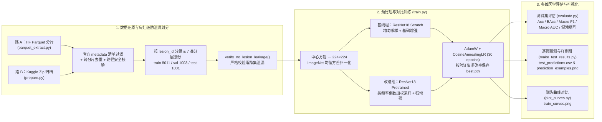
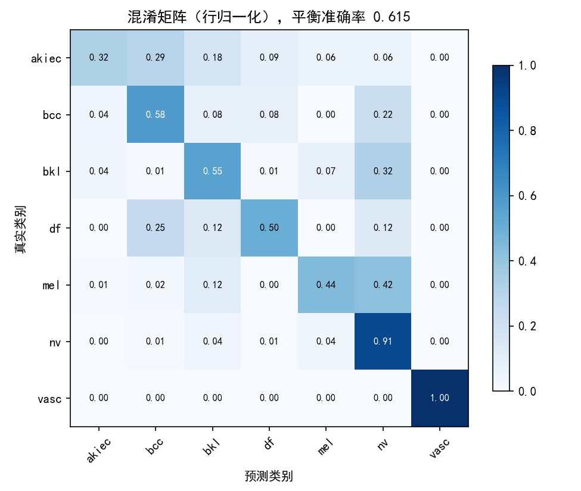
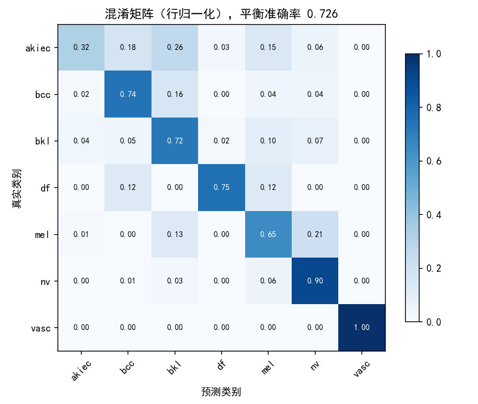
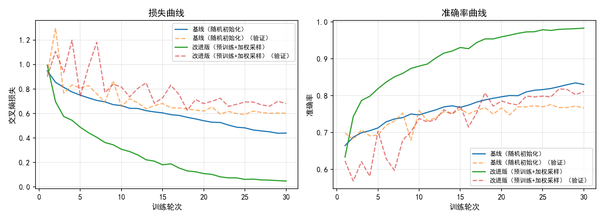
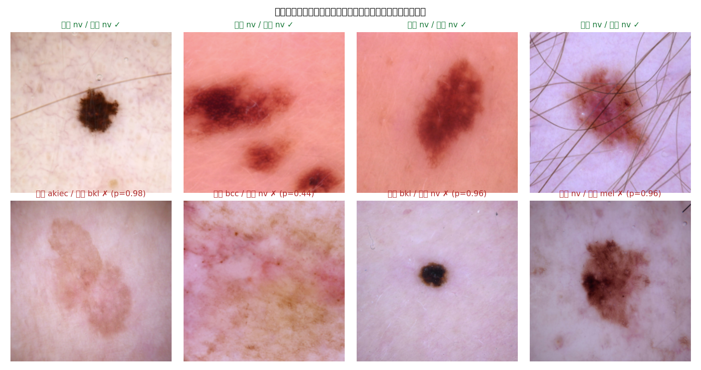

# 基于皮肤镜图像的皮肤病变七分类（HAM10000）

[](https://www.python.org/)
[](https://pytorch.org/)
[-1B6B7A)](https://dataverse.harvard.edu/dataset.xhtml?persistentId=doi:10.7910/DVN/DBW86T)
[](https://github.com/yunyancuo/skin-lesion-classification/actions/workflows/ci.yml)
[](https://docs.astral.sh/ruff/)

面向医学皮肤镜图像的 7 类皮肤病变自动分类完整工程流水线，基于公开数据集 **HAM10000**（10,015 张皮肤镜图像 / 7,470 个独立病灶）。本项目聚焦医学影像分类中的两大核心难题：

1. **病灶级防数据泄漏**：同一病灶常对应多张不同角度、焦距的照片，按图像随机划分会导致训练/测试泄漏与指标虚高。本项目在两条数据管线中统一实施 **按 `lesion_id` 分组 + 按类别分层划分**，并在落盘前自动执行零跨集泄漏强校验。
2. **极端类别不平衡（58:1）**：多数类黑色素细胞痣 `nv` 占 66.9%（6,705 张），皮肤纤维瘤 `df` 仅占 1.1%（115 张），高危恶性黑色素瘤 `mel` 占 11.1%（1,113 张）。本项目采用 **ImageNet 预训练微调 + 类频率倒数加权采样 + 针对采集差异的强增强**，以 **Balanced Accuracy、Macro F1、Macro AUC 与恶性类召回率** 作为核心评估体系。

---

## 数据划分与训练评估流水线



---

## 实测实验结果（测试集 n = 1,001 / 747 个独立病灶）

> 以下全部数值均来自真实测试集评估产物（单张 RTX 4090，PyTorch 2.11，30 epochs，固定随机种子 `42`，训练过程测试集完全不可见），详细分析见 [实验报告.md](实验报告.md) 与 [results/测试结果.md](results/测试结果.md)。

### 1. 实验方案与总体指标对比

| 实验分组 | 训练配置 | Accuracy | Balanced Accuracy | Macro F1 | Macro AUC (OvR) |
|---|---|---:|---:|---:|---:|
| **基线组（Scratch）** | ResNet18 随机初始化 + 均匀采样 + 基础增强 | 0.7772 | 0.6146 | 0.6071 | 0.9384 |
| **消融预留（Pretrained 无加权）** | ResNet18 ImageNet 预训练 + 均匀采样（计划消融项，当前未单独运行） | — | — | — | — |
| **改进组（Pretrained + Weighted）** | ResNet18 ImageNet 预训练 + 类频率倒数加权采样 + 强增强 | **0.8272** | **0.7261** | **0.7079** | **0.9610** |
| **相对基线提升** | 改进组 vs 基线组 | **+5.0 pt** | **+11.2 pt** | **+10.1 pt** | **+2.3 pt** |
| **文献参考区间（ResNet 级）** | HAM10000 同规模 ResNet 模型常见报道水平 | 0.83 ~ 0.87 | 0.65 ~ 0.75 | — | 0.91 ~ 0.94 |

- **核心结论**：越公平的指标提升幅度越大（Balanced Accuracy **+11.2 pt**、Macro F1 **+10.1 pt**），说明性能增益主要来自中低频及高危类别，而非迎合多数类 `nv`。对照同规模 ResNet 文献区间：Balanced Accuracy（0.7261）达到文献水平、Macro AUC（0.9610）超过文献上限（0.94）、Accuracy（0.8272，1001 张中 828 张判对）与文献下限基本持平。

### 2. 七类皮肤病变召回率对比

| 类别代码 | 病变名称 | 临床性质 | 全量样本数（占比） | 测试图数 | 基线召回率 | 改进版召回率 | 变化 |
|---|---|---|---:|---:|---:|---:|---:|
| `akiec` | 光化性角化病 | 癌前病变 | 327 (3.3%) | 34 | 0.324 | 0.324 | ±0 |
| `bcc` | 基底细胞癌 | **恶性** | 514 (5.1%) | 50 | 0.580 | **0.740** | **+16 pt** |
| `bkl` | 良性角化病 | 良性 | 1,099 (11.0%) | 107 | 0.551 | **0.720** | **+17 pt** |
| `df` | 皮肤纤维瘤 | 良性 | 115 (1.1%) | 8 | 0.500 | **0.750** | **+25 pt** |
| `mel` | 黑色素瘤 | **恶性** | 1,113 (11.1%) | 113 | 0.442 | **0.646** | **+20 pt** |
| `nv` | 黑色素细胞痣 | 良性（大类） | 6,705 (66.9%) | 674 | 0.905 | 0.904 | ±0 |
| `vasc` | 血管性病损 | 良性 | 142 (1.4%) | 15 | 1.000 | 1.000 | ±0 |

- 恶性黑色素瘤 `mel` 召回率提升 **+20 pt**（0.442 → 0.646），将 `mel` 误判为良性痣 `nv` 的比例砍半（**41.6% → 21.2%**）；
- 多数类 `nv` 召回率几乎零损失（0.905 → 0.904），精确率反而由 0.865 提升至 **0.944**。

### 3. 核心可视化产物预览

| 基线混淆矩阵（Balanced Acc 0.615） | 改进版混淆矩阵（Balanced Acc 0.726） |
|---|---|
|  |  |

| 训练与验证曲线对比 | 测试集逐图预测示例（上排判对 / 下排判错） |
|---|---|
|  |  |

---

## 目录结构

```text
skin-lesion-classification/
├── .github/workflows/
│   └── ci.yml                       # GitHub Actions：Ruff 静态检查 + 离线 Pytest 套件
├── data/
│   └── README.md                    # HAM10000 数据获取与放置说明（原始大图不入库）
├── src/
│   ├── prepare.py                   # Kaggle zip 安全解包 + 病灶级分层划分 + 零泄漏校验
│   ├── parquet_extract.py           # HF parquet 流式还原 + 官方清单过滤 + 病灶级划分
│   ├── dataset.py                   # HAMDataset、安全读图、预处理与除零防护类权重计算
│   ├── models.py                    # ResNet18（scratch / ImageNet pretrained）构建
│   ├── train.py                     # 统一训练入口（支持加权采样、强增强与可复现种子）
│   ├── evaluate.py                  # 测试评估（Acc / BAcc / Macro F1 / Macro AUC / 混淆矩阵）
│   ├── make_test_results.py         # 导出逐图预测明细 CSV 与 2×4 预测对/错示例图
│   ├── eda.py                       # 类别分布柱状图与每类样例图生成
│   ├── plot_curves.py               # 多实验训练/验证损失与准确率曲线绘制
│   └── cn_font.py                   # 跨平台 Matplotlib 中文字体统一配置
├── tests/                           # 离线自动化单元测试（无需大型数据集即可快速运行）
│   ├── test_prepare_and_leakage.py  # 病灶级划分零泄漏校验与 Zip Slip 安全测试
│   ├── test_parquet_extract.py      # Parquet 流式还原、去重与目录穿越防护测试
│   ├── test_dataset_and_weights.py  # 类别权重除零/缺失类防护与 Dataset 测试
│   ├── test_metrics_and_results.py  # 多分类指标边界、sklearn 等价性与结果导出测试
│   ├── test_plotting_and_utils.py   # 绘图句柄释放、单行日志与 EDA 边界测试
│   └── test_models.py               # ResNet18 构建与前向输出形状测试（自动适配 torch）
├── figures/                         # 报告与 README 使用的真实实验图表
├── results/
│   ├── 测试结果.md                   # 测试集指标摘要与复现记录
│   ├── test_predictions.csv         # 1,001 张测试图逐图预测明细
│   └── prediction_examples.png      # 2×4 预测示例图
├── report_build/                    # Word 实验报告生成脚本与结构化内容
├── video_build/                     # 课程验收演示视频合成脚本
├── 实验报告.md                       # 完整 Markdown 实验报告
├── HAM10000实验报告.docx / .pdf     # 定稿课程实验报告（Word / PDF）
├── HAM10000演示视频.mp4             # 课程验收演示视频（720p）
├── pyproject.toml                   # Ruff 与 Pytest 工程配置
└── requirements.txt                 # Python 依赖清单
```

---

## 环境配置与实验复现

### 1. 安装依赖

建议使用 Python 3.10+ 虚拟环境：

```bash
pip install -r requirements.txt
```

> 若仅需运行离线单元测试与数据/可视化工具（不跑 GPU 训练），可仅安装轻量依赖：`pip install pytest ruff numpy matplotlib pillow pyarrow opencv-python-headless scikit-learn`。

### 2. 数据准备（两条路径任选其一）

详见 [data/README.md](data/README.md)：

```bash
# 路 A（本次实验实际采用）：HF 镜像 parquet 还原 + 官方清单过滤（剔除镜像额外 3,339 张）+ 病灶级划分
# 先将 marmal88/skin_cancer 的 8 个 parquet 分片与 HAM10000_metadata.csv 放入 data_src/
python src/parquet_extract.py --src-dir data_src --out-dir data/ham10000

# 路 B：Kaggle 原始压缩包（kmader/skin-cancer-mnist-ham10000）
python src/prepare.py --zip data/ham10000.zip --out-dir data/ham10000
```

### 3. EDA、训练、评估与结果导出

```bash
# 1) 生成 EDA 类别分布图与样例图
python src/eda.py --data-dir data/ham10000 --out-dir outputs/figures

# 2) 训练基线与改进模型（固定种子 42，各 30 epochs）
python src/train.py --model resnet18_scratch --augment base --epochs 30
python src/train.py --model resnet18_pretrained --weighted --augment strong --epochs 30

# 3) 测试集多维指标评估与混淆矩阵绘制
python src/evaluate.py --weights outputs/scratch/checkpoints/best.pth
python src/evaluate.py --weights outputs/pretrained_weighted/checkpoints/best.pth

# 4) 导出逐图预测明细 CSV 与 2×4 预测示例图
python src/make_test_results.py --weights outputs/pretrained_weighted/checkpoints/best.pth --out-dir results

# 5) 绘制基线与改进版训练曲线对比图
python src/plot_curves.py \
    --logs outputs/scratch/train_log.csv outputs/pretrained_weighted/train_log.csv \
    --names "ResNet18 (scratch)" "ResNet18 (pretrained+weighted)" \
    --out outputs/figures/train_curves.png
```

> **预训练权重离线说明**：ImageNet 预训练权重默认缓存于 `~/.cache/torch/hub/checkpoints/resnet18-f37072fd.pth`。若网络无法直连 `download.pytorch.org`，可先在可联网环境下载后手动放入缓存目录（或读取旧版 `resnet18-5c106cde.pth` 权重后重新保存）。

---

## 自动化测试与代码质量检查

本项目内置不依赖外部大型数据集的离线 `pytest` 单元测试套件，重点覆盖 **病灶级防数据泄漏校验、路径穿越防护、类别加权除零边界、缺失类别指标计算与 Matplotlib 内存释放**：

```bash
# 静态代码检查
ruff check src tests

# 运行全部离线单元测试（无 torch 环境自动跳过模型测试，其余测试全部执行）
pytest -v
```

---

## 后续改进方向（Roadmap）

1. **三项改进逐项消融**：补齐 `ResNet18 Pretrained（无加权）`、`+加权采样`、`+强增强` 独立消融对照，并扩展至 ResNet50 / ConvNeXt / EfficientNet 骨干。
2. **临床连续谱系建模**：针对 `akiec` 与 `bkl` 难分问题引入类别代价敏感损失或利用元数据中的确诊手段 (`dx_type`) 建模标注不确定性。
3. **病灶级推理聚合与 TTA**：对同一 `lesion_id` 的多张皮肤镜照片进行概率聚合，并结合测试时增强（TTA）与验证集阈值校准进一步压低 `mel` 漏诊率。
4. **可解释性核验**：结合 Grad-CAM 检查模型是否关注皮肤病变本体而非毛发、标尺等采集伪影。
